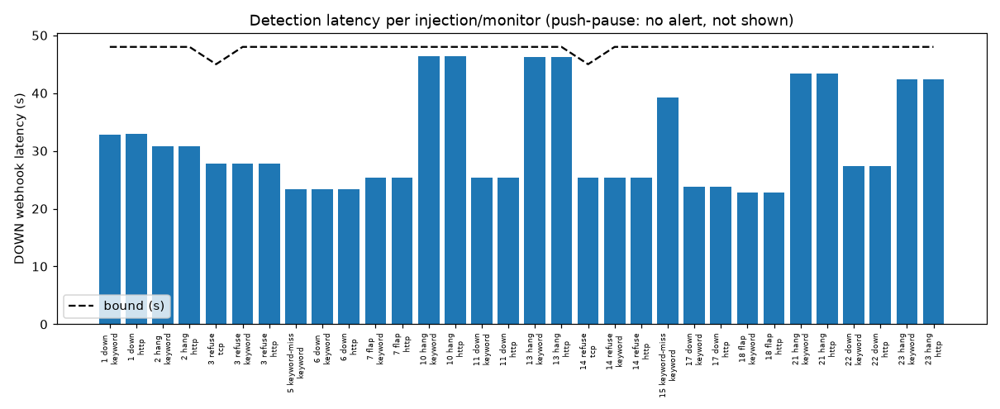
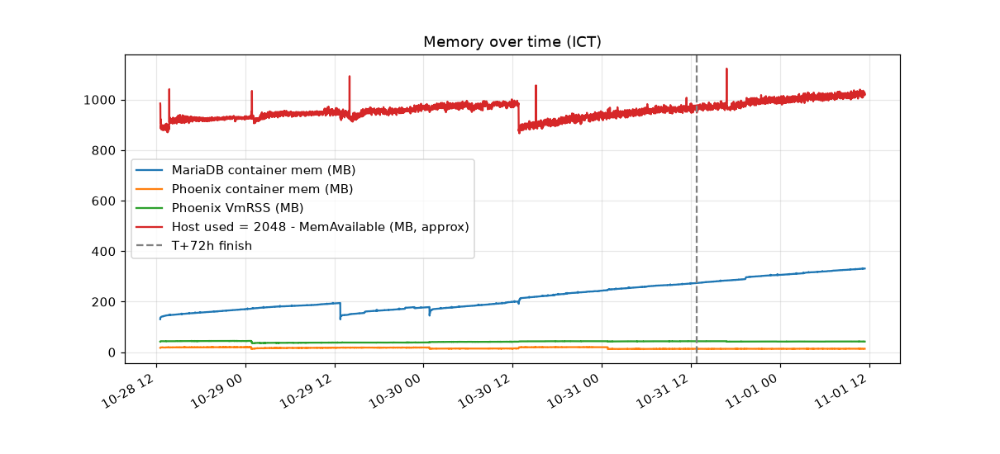
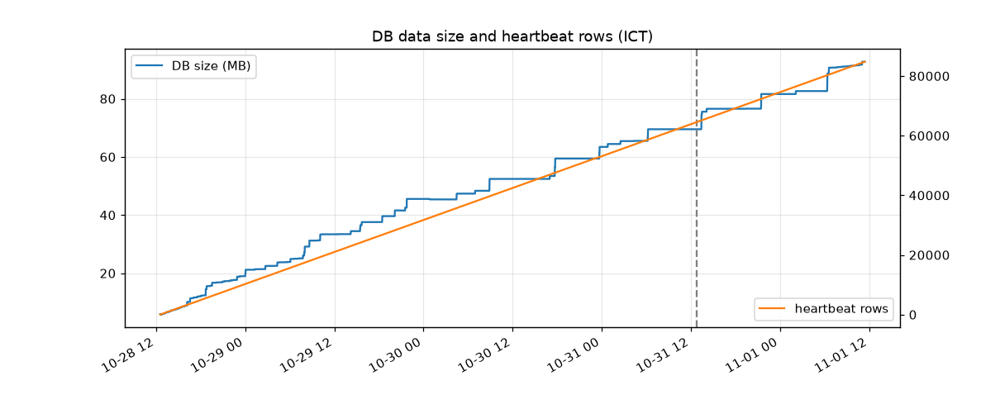

# Single-node long-run soak: v0.6.2 — November 1, 2026

This page describes a historical execution. It records a ~4-day soak of the published
`ghcr.io/fiztoz/uptime-phoenix:0.6.2` image with Docker Compose on one node. It is
**not** M6 operational acceptance. The campaign harness, raw data and receipts stay local, per
[documentation scope](DOCUMENTATION.md#current-validation-reporting-scope).

**Result:** the service stayed available and alerted correctly for HTTP, keyword and
TCP faults. **The 2 push-pause injections (#9 and #19) failed**: no DOWN or UP alert
was sent. Heartbeat retention/pruning is **unproven**. All times below are ICT (UTC+7).

## Setup

| Item | Value |
| --- | --- |
| Image | `ghcr.io/fiztoz/uptime-phoenix:0.6.2` (arm64). Fresh install, no upgrade phase. `MODE=all`, `PRODUCTION=true`, MariaDB `11.8` (`parseTime=true&loc=UTC`) |
| Host | One AWS `t4g.small` (2 vCPU Graviton, 2 GiB, 1 GiB swap, 20 GB gp3), Ubuntu 24.04, ap-southeast-1. No inbound rules; access through SSM only |
| Window | Boot Oct 28 12:31. Injections ran from T = Oct 28 12:48 to finish at Oct 31 12:48 (72 h). Idle sampling continued to Nov 1 11:24, when the data was pulled and the host terminated |
| Sidecars | Flip-able HTTP target (`up`/`down` 503/`hang` 30 s/`keyword-miss`/`refuse`), webhook sink (arrival ms, fsync per delivery), Mailpit SMTP sink, a 20 s push sender and a 60 s host sampler |
| Monitors | http, keyword and tcp on the target (20 s / retry 20 s / max_retries 1); push (60 s); self `/api/health/ready` (60 s); 2 public HTTP (120 s) and 1 DNS (300 s) as a false-positive baseline. Every monitor has both webhook and SMTP notifications |
| Integrity | Bundle sha256 `d8497fa2…`, 27 files, all checksums verified after the pull |

## Fault injections: 21 of 23 passed, 2 FAILED

Down and hang faults are expected to alert on http and keyword; keyword-miss on keyword; refuse
on http, keyword and tcp; push-pause on push. The latency bound is interval × (max_retries + 1) +
timeout: 48 s for http/keyword and 45 s for tcp. The alert columns give the webhook/mail count
per expected monitor. A negative recovery time means the final UP arrived before the fault
window closed (flap).

| # | type | monitors expected | start–end ICT | DOWN hook/mail | UP hook/mail | detect latency s (bound) | recovery s | result |
|---|---|---|---|---|---|---|---|---|
| 1 | down 90s | http-target, keyword-target | 10-28 14:37:12–10-28 14:38:42 | 1/1 1/1 | 1/1 1/1 | 32.9 32.8 (48,48) | +3.8 +3.8 | PASS |
| 2 | hang 120s | http-target, keyword-target | 10-28 18:31:12–10-28 18:33:12 | 1/1 1/1 | 1/1 1/1 | 30.8 30.8 (48,48) | +5.8 +5.8 | PASS |
| 3 | refuse 300s | http-target, keyword-target, tcp-target | 10-28 22:36:12–10-28 22:41:12 | 1/1 1/1 1/1 | 1/1 1/1 1/1 | 27.8 27.8 27.8 (48,48,45) | +17.5 +17.5 +17.5 | PASS |
| 4 | app-restart | (none; ops event) | 10-29 00:48:12–10-29 00:48:12 | 0 alerts | – | ready after 0.4 s | – | PASS |
| 5 | keyword-miss 600s | keyword-target | 10-29 02:40:12–10-29 02:50:12 | 1/1 | 1/1 | 23.4 (48) | +0.4 | PASS |
| 6 | down 1800s | http-target, keyword-target | 10-29 07:06:12–10-29 07:36:12 | 1/1 1/1 | 1/1 1/1 | 23.4 23.4 (48,48) | +10.4 +10.4 | PASS |
| 7 | flap 60s | http-target, keyword-target | 10-29 10:40:12–10-29 10:41:12 | 1/1 1/1 | 1/1 1/1 | 25.4 25.4 (48,48) | -13.7 -13.7 | PASS |
| 8 | db-restart | (none; ops event) | 10-29 12:48:12–10-29 12:48:20 | 0 alerts | – | ready after 8.4 s | – | PASS |
| 9 | push-pause 300s | push | 10-29 14:54:12–10-29 14:59:12 | 0/0 | 0/0 | none (130) | none | **FAIL** |
| 10 | hang 120s | http-target, keyword-target | 10-29 18:34:12–10-29 18:36:12 | 1/1 1/1 | 1/1 1/1 | 46.4 46.4 (48,48) | +1.4 +1.4 | PASS |
| 11 | down 900s | http-target, keyword-target | 10-29 22:42:12–10-29 22:57:12 | 1/1 1/1 | 1/1 1/1 | 25.4 25.4 (48,48) | +10.4 +10.3 | PASS |
| 12 | stack-recreate | (none; ops event) | 10-30 00:48:12–10-30 00:48:30 | 0 alerts | – | ready after 18.1 s | – | PASS |
| 13 | hang 3600s | http-target, keyword-target | 10-30 02:29:12–10-30 03:29:12 | 1/1 1/1 | 1/1 1/1 | 46.3 46.3 (48,48) | +1.3 +1.3 | PASS |
| 14 | refuse 90s | http-target, keyword-target, tcp-target | 10-30 06:29:12–10-30 06:30:42 | 1/1 1/1 1/1 | 1/1 1/1 1/1 | 25.3 25.3 25.3 (48,48,45) | +15.8 +15.8 +15.9 | PASS |
| 15 | keyword-miss 120s | keyword-target | 10-30 10:59:12–10-30 11:01:12 | 1/1 | 1/1 | 39.3 (48) | +0.2 | PASS |
| 16 | reboot | (none; ops event) | 10-30 12:48:12–10-30 12:48:43 | 0 alerts | – | ready after 31.1 s | – | PASS |
| 17 | down 300s | http-target, keyword-target | 10-30 14:54:12–10-30 14:59:12 | 1/1 1/1 | 1/1 1/1 | 23.8 23.8 (48,48) | +14.8 +14.8 | PASS |
| 18 | flap 600s | http-target, keyword-target | 10-30 18:54:12–10-30 19:04:12 | 6/6 6/6 | 6/6 6/6 | 22.8 22.8 (48,48) | -250.4 -250.5 | PASS |
| 19 | push-pause 1800s | push | 10-30 23:03:12–10-30 23:33:12 | 0/0 | 0/0 | none (130) | none | **FAIL** |
| 20 | app-restart | (none; ops event) | 10-31 00:48:12–10-31 00:48:13 | 0 alerts | – | ready after 1.3 s | – | PASS |
| 21 | hang 60s | http-target, keyword-target | 10-31 02:30:12–10-31 02:31:12 | 1/1 1/1 | 1/1 1/1 | 43.4 43.4 (48,48) | +17.3 +17.3 | PASS |
| 22 | down 300s | http-target, keyword-target | 10-31 06:33:12–10-31 06:38:12 | 1/1 1/1 | 1/1 1/1 | 27.4 27.4 (48,48) | +12.3 +12.3 | PASS |
| 23 | hang 120s | http-target, keyword-target | 10-31 10:55:12–10-31 10:57:12 | 1/1 1/1 | 1/1 1/1 | 42.4 42.4 (48,48) | +17.3 +17.3 | PASS |

**Failures:**
- **#9 push-pause 300 s** (Oct 29 14:54:12–14:59:12): the push monitor sent no DOWN or UP alert on either channel.
- **#19 push-pause 1800 s** (Oct 30 23:03:12–23:33:12): the push monitor sent no DOWN or UP alert on either channel.
- **Cause:** throughout the run, the push checker wrote PENDING `push: awaiting first push`
  about every 60 s (5,635 rows). Received pushes wrote UP (16,944 rows). The monitor never
  reached DOWN.

**Latency:**
- DOWN latency over 32 monitor-events: p50 27.8 s, p95 46.3 s, max 46.4 s. None was over bound. Hang faults sit close to it (42–46 s against 48 s).
- UP latency: p50 12.3 s, max 17.5 s.

**Flap #18:** the 600 s flap alerted on 6 of its 10 flips. Later failures reached PENDING, and
the retry check landed in an up half-cycle. That matches `max_retries=1` and is not counted as
a miss.

## Alert reconciliation

- **Webhooks:** 84 = 42 DOWN + 42 UP (keyword 21+21, http 19+19, tcp 2+2). Push, public, DNS and self sent 0.
- **Mails:** 84. Each webhook matched exactly one mail with the same monitor and status within 5 s, so the two channels are 1:1 (median delta 6 ms, max 46 ms).
- **Missed:** 2 events (#9 and #19), on both channels.
- **Duplicates:** 0.
- **Spurious** (any alert outside a fault window, including the public baseline): 0.
- **Ops events:** app restart ×2, DB restart, full stack recreate and OS reboot raised 0 alerts. Readiness returned after 0.4, 1.3, 8.4, 18.1 and 31.1 s.

## Uptime and heartbeat continuity

- `/api/health/ready` returned 200 in 5,601 of 5,601 sampler minutes.
- The app started 5 times, all planned.
- After the reboot, the app exited 6 times within 5 s (`ping mariadb … connection refused`) before
  MariaDB was ready. Docker's restart policy recovered it.
- **Expected gaps:** 38 s at the stack recreate and 46 s at the reboot.
- **Unexpected gaps:** 10 heartbeats were lost. 8 show as single missed intervals; 2 hit the
  push monitor, where they can't be seen as gaps. Each matches one `Error 1020` log line (below).
- The partition rolled over at Nov 1 07:00 with no gap; `p202611` holds rows.

## Errors

These come from the app log of the container started at the Oct 30 00:48 stack recreate and later. Earlier container
logs were not retained, so errors before that point are not measurable; the first-start log had none.
There were no panics.

| Count | Level | Message | First – last |
| --- | --- | --- | --- |
| 156 | WARN | `ws hub: dropping event with no resolvable monitor id type=""` | Oct 31 00:48:12 (one burst at app restart) |
| 10 | ERROR | `scheduler: failed to record heartbeat … Error 1020 (HY000): Record has changed since last read in table 'probe_dirty_buckets'` | Oct 30 02:02 – Nov 1 00:48 |
| 6 + 6 | ERROR | `failed to connect to mariadb` / `can't discover MySQL version … connection refused` | Oct 30 12:48:34–39 (reboot) |
| 1 | ERROR | `scheduler stopped with error: context canceled` | Oct 31 00:48:12 (shutdown) |

The push sender also received a 404 during the DB restart and two 500 responses (Oct 30 07:28:00,
Oct 31 19:19:01) that had no matching log line.

## Resources

The slopes are least-squares fits per day over the whole sampling window (MiB).

| Metric | First → last | Max | Slope/day | Shape |
| --- | --- | --- | --- | --- |
| MariaDB container memory | 137 → 347 MB | 348 MB | +47.7 (≈75 MB/day since the last DB restart) | Linear, not levelling off; resets on DB restart |
| DB data size | 6.2 → 97.2 MB | 97.2 MB | +20.6 | Linear; ~21.4k heartbeat rows/day, ~1.1 KB/row |
| App container memory / VmRSS | 17 → 14 / 42 → 42 MiB | 20 / 45 MiB | −1.6 / +0.7 | Flat |
| App CPU | p95 1.6 % | 67 % (startup) | — | Flat |
| Host MemAvailable | 1063 → 1028 MiB | min 925 MiB | −19 | Swap unused |
| Root disk used | 4.44 → 4.64 GiB | — | +0.04 GiB | 13.7 GiB free |

**MariaDB memory:** container memory includes page cache, so this data can't separate cache
warm-up from a leak.

**Retention is unproven.** All 84,780 heartbeat rows were still present at the end, so no
pruning was observed. The window is shorter than any retention setting, so this run neither
proves nor disproves that retention works.

## Cost estimate

This is an estimate from on-demand list prices, not billing data. The free tier is ignored. The run lasted about
95–96.5 h (the termination time was not in the pulled data).

| Item | Estimate |
| --- | --- |
| t4g.small at $0.0212/h | $2.01–2.05 |
| Public IPv4 at $0.005/h | $0.48 |
| gp3 20 GB | $0.25 |
| SSM, IAM, security group, basic metrics | $0 |
| Data transfer out (under 1 GB, not measured) | ≈ $0 |
| **Total** | **≈ $2.75–2.80** |

## What this proves and what it does not

**Proves (for this single run):**
- A single-node v0.6.2 Compose deployment on arm64 with MariaDB 11.8 stayed available for ~4 days.
- It survived app and DB restarts, a full stack recreate and an OS reboot.
- It alerted within bound, on both webhook and SMTP, for the 21 HTTP/keyword/TCP and ops injections.
- It sent no false or duplicate alerts.
- Monthly heartbeat partitions rolled over cleanly.

**Does not prove:**
- That push monitors work. They **failed**.
- Remote probes or multi-region operation, which were off. That includes the M6
  24-hour probe-to-hub fault/recovery criterion, which this run does not satisfy.
- M7 aggregate paging (off).
- M8 SSH/Docker probe installation (off).
- HA, split API/worker mode, Helm or Kubernetes.
- Retention/pruning (**unproven**).
- Upgrade from an earlier release.
- Backup/restore.
- Load beyond 8 monitors.
- Behaviour on SQLite or amd64.
- Billing.

## Follow-up candidates

Bugs 1–5 are being filed separately.

1. **Push monitor never goes DOWN.** (issue: TBD) The checker reports `push: awaiting first push` despite
   received pushes, so push-pause faults don't alert (#9 and #19).
2. **Heartbeats lost to MariaDB `Error 1020` on `probe_dirty_buckets` with probes disabled.** (issue: TBD)
   The write is not retried; 10 heartbeats were lost.
3. **The app exits instead of retrying** (issue: TBD) when MariaDB is not yet reachable at boot.
4. **The push endpoint returns 404 during a DB outage** (issue: TBD) (503 expected), and two 500s had no log line.
5. **(Low)** (issue: TBD) WARN burst `ws hub: dropping event with no resolvable monitor id` on shutdown.

Watch item (tracked here only, no issue): linear MariaDB container memory growth of about 48–75 MB/day. A longer run with a fixed `innodb_buffer_pool_size` and cache-excluded RSS would separate cache from a leak.
